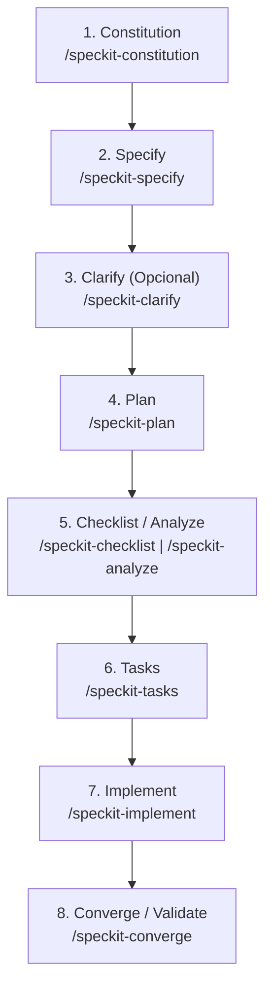

# GitHub Spec Kit (SDD) - Guía e Instalación del Proyecto

## 1. ¿Qué es GitHub Spec Kit (`spec-kit`)?

**Spec Kit** es un toolkit oficial de código abierto desarrollado por GitHub ([github/spec-kit](https://github.com/github/spec-kit)) diseñado para implementar **Specification-Driven Development (SDD)** en flujos de trabajo asistidos por agentes de Inteligencia Artificial (como Antigravity, Claude Code, GitHub Copilot, Gemini CLI, Cursor, etc.).

A diferencia del *"vibe coding"* tradicional —donde el programador salta directamente a generar código sin especificaciones previas y el contexto se degrada rápidamente— Spec Kit invierte el flujo: **la especificación estructurada funciona como el plano de construcción ejecutable para el agente de IA**.

---

## 2. Niveles y Filosofía de SDD

- **Nivel 1: Spec-first:** La especificación guía la tarea inicial.
- **Nivel 2: Spec-anchored:** La especificación se mantiene viva y evoluciona con el proyecto para cambios futuros.
- **Nivel 3: Spec-as-source:** El humano edita principalmente la especificación; la IA se encarga de la implementación en código.

### Spec vs. Contexto
- **Contexto:** Vive en la sesión actual y es volátil.
- **Spec:** Es persistente, vive en el repositorio y acompaña el ciclo de vida del módulo o funcionalidad.

---

## 3. Ciclo de Vida de Spec Kit

El flujo de trabajo se divide en dos componentes principales:

1. **Conocimiento Persistente:** Principios globales, arquitectura y estándares (Constitución y steering).
2. **Especificación por Tarea:** Requisitos funcionales, diseño técnico y criterios de validación.



### Fases del Ciclo:
1. **Constitution (`/speckit-constitution`):** Define principios, límites de seguridad, convenciones y directrices no negociables del proyecto.
2. **Specify (`/speckit-specify`):** Captura el **qué** y el **por qué** (requisitos de usuario, historias, casos de uso y criterios de aceptación verificables), evitando detalles de implementación prematuros.
3. **Clarify (`/speckit-clarify`):** Formula preguntas estructuradas para resolver ambigüedades y casos borde antes de pasar al diseño técnico.
4. **Plan (`/speckit-plan`):** Traduce la intención en arquitectura técnica, flujos, interfaces y restricciones (**cómo** se construirá).
5. **Checklist & Analyze (`/speckit-checklist`, `/speckit-analyze`):** Valida la consistencia cruzada entre especificación, plan y tareas antes de codificar.
6. **Tasks (`/speckit-tasks`):** Desglosa el plan técnico en tareas de trabajo atómicas, ordenadas por dependencias y listas para el agente.
7. **Implement (`/speckit-implement`):** El agente de IA genera el código y los tests asociados tarea por tarea.
8. **Converge / Validate (`/speckit-converge`):** Evalúa el código resultante frente a la especificación para confirmar que todo fue implementado según lo acordado.

---

## 4. Instalación y Configuración en este Proyecto

### Requisitos Detectados
- **Git:** Instalado (`git init` configurado en el repositorio).
- **Python / uv:** uv 0.11+ instalado.
- **Specify CLI:** `specify-cli` v0.16.4 instalado vía uv tools.

### Comando Ejecutado
Para inicializar Spec Kit con soporte nativo para **Antigravity** (`agy`) y scripts de PowerShell (`ps`):

```powershell
specify init --here --force --integration agy --script ps
```

### Estado de la Integración
Verificación ejecutada mediante `specify integration status`:
- **Estado:** OK
- **Integración por defecto:** `agy` (Antigravity)
- **Modo de scripts:** PowerShell (`.ps1`)

---

## 5. Estructura de Archivos Generada

```text
.
├── .agents/
│   └── skills/
│       ├── speckit-constitution/    # Definir principios y reglas del proyecto
│       ├── speckit-specify/         # Crear y actualizar especificaciones
│       ├── speckit-clarify/         # Resolver dudas y ambigüedades
│       ├── speckit-plan/            # Generar el plan técnico de arquitectura
│       ├── speckit-checklist/       # Listas de verificación de requerimientos
│       ├── speckit-tasks/           # Desglose en tareas atómicas
│       ├── speckit-analyze/         # Análisis cruzado de coherencia
│       ├── speckit-implement/       # Ejecución de tareas de código
│       ├── speckit-converge/        # Validación y detección de pendientes
│       └── speckit-taskstoissues/   # Conversión de tareas a GitHub Issues
│
├── .specify/
│   ├── memory/
│   │   └── constitution.md          # Constitución activa del proyecto
│   ├── templates/                   # Plantillas markdown para spec, plan, tasks, etc.
│   ├── scripts/powershell/          # Scripts de soporte para ramas y features
│   └── workflows/speckit/           # Definición de flujos y pipelines
│
├── Desmitificando el vibe coding...
├── GitHub-Spec-Kit-Workflow.webp
├── Notas2.md
└── SDDfLOW.pdf
```

---

## 6. Comandos / Habilidades Disponibles para el Agente

| Comando / Skill | Momento de Uso | Propósito |
| :--- | :--- | :--- |
| `/speckit-constitution` | Inicio del proyecto | Establecer o actualizar directrices globales y reglas de arquitectura |
| `/speckit-specify` | Nuevo módulo o feature | Definir requerimientos de negocio y criterios de aceptación |
| `/speckit-clarify` | Post-especificación | Identificar y aclarar zonas grises antes de diseñar |
| `/speckit-plan` | Antes de codificar | Crear el plan técnico arquitectónico |
| `/speckit-checklist` | Post-plan | Generar checklist de calidad de la especificación |
| `/speckit-tasks` | Post-plan | Generar lista ordenada de tareas técnicas |
| `/speckit-analyze` | Pre-implementación | Análisis de coherencia entre spec, plan y tareas |
| `/speckit-implement` | Fase de desarrollo | Ejecutar la construcción de código y tests |
| `/speckit-converge` | Post-implementación | Auditar el código frente al spec y listar pendientes |

