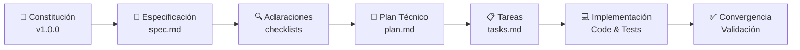

# 📦 Control de Inventario FIFO por Códigos de Colores y Registro Rápido

> **Proyecto de Product Engineering con Inteligencia Artificial — Clase 2**  
> Implementado bajo la metodología **Specification-Driven Development (SDD)** utilizando **GitHub Spec Kit** integrado nativamente con **Google Antigravity (`agy`)**.

---

## 🎯 Propósito del Proyecto

Este sistema tiene como objetivo optimizar y simplificar la gestión logística en almacenes y centros de distribución con alta rotación o trabajo de **voluntarios**, asegurando una estricta rotación **FIFO (First-In, First-Out)** mediante:

1. **Captura Rápida Híbrida**: Registro de entradas en menos de 8 segundos mediante lectores ópticos de código de barras/QR o atajos de teclado numérico sin ratón.
2. **Sistema Semáforo de Urgencia (`skills_marca`)**: Indicadores visuales en alto contraste para priorizar la salida de lotes según su fecha de caducidad.
3. **Despacho Asistido Inteligente**: Preselección obligatoria del lote más urgente, impidiendo salidas accidentales de lotes frescos y calculando particiones automáticas de pedidos.
4. **UX Inclusiva para Voluntarios**: Interfaz basada en fuentes sans-serif legibles a distancia e iconografía universal (cajas, flechas de rotación) para minimizar la fricción en personal con cualquier nivel de alfabetización digital.

---

## 🚦 Paleta Cromática y Reglas Semáforo (`skills_marca`)

El sistema clasifica y resalta visualmente los lotes según su urgencia de rotación:

| Color | Código Hex | Criterio de Activación | Acción Operativa |
| :--- | :--- | :--- | :--- |
| 🔴 **Rojo Urgente** | `#E53E3E` | Vencimiento menor a **48 horas** | **Prioridad absoluta de salida.** El sistema exige su despacho inmediato. |
| 🟡 **Amarillo Precaución** | `#D69E2E` | Vencimiento entre **3 y 7 días** | Lote en rotación preventiva antes de entrar a zona crítica. |
| 🟢 **Verde Seguro** | `#38A169` | Vencimiento **> 7 días** o no perecederos | Almacenamiento seguro. Salida regida por orden cronológico FIFO de entrada. |

---

## 🔄 Metodología SDD (Specification-Driven Development)

El proyecto sigue el flujo de trabajo de **GitHub Spec Kit**, reemplazando el "vibe coding" tradicional por un proceso estructurado en artefactos y gobernanza:



### Comandos de Spec Kit Disponibles en este Entorno:

| Comando | Función en el Flujo |
| :--- | :--- |
| `/speckit-constitution` | Define y ratifica los principios no negociables y gobernanza del proyecto. |
| `/speckit-specify` | Modela los requerimientos de negocio, historias de usuario y criterios de éxito. |
| `/speckit-clarify` | Resuelve dudas estructurales y ambigüedades antes de pasar a la arquitectura. |
| `/speckit-plan` | Traduce la especificación a arquitectura técnica, componentes y contratos. |
| `/speckit-checklist` | Genera listas de verificación de calidad de la especificación y diseño. |
| `/speckit-tasks` | Desglosa el plan técnico en tareas atómicas y ordenadas por dependencias. |
| `/speckit-analyze` | Evalúa la coherencia cruzada entre especificación, plan y tareas. |
| `/speckit-implement` | Ejecuta la generación iterativa de código y pruebas automatizadas. |
| `/speckit-converge` | Audita el código generado contra la especificación para certificar cumplimiento. |

---

## 📁 Estructura del Repositorio

```text
.
├── .agents/
│   └── skills/
│       ├── skills-marca/               # Guía de marca, colores semáforo y UX inclusiva
│       ├── speckit-constitution/       # Skill para gobernanza del proyecto
│       ├── speckit-specify/            # Skill para redacción de especificaciones
│       ├── speckit-clarify/            # Skill para resolución de ambigüedades
│       ├── speckit-plan/               # Skill para diseño de arquitectura técnica
│       ├── speckit-checklist/          # Skill para listas de validación
│       ├── speckit-tasks/              # Skill para desglose de tareas ejecutables
│       ├── speckit-analyze/            # Skill para coherencia de artefactos
│       ├── speckit-implement/          # Skill para generación guiada de código
│       ├── speckit-converge/           # Skill para auditoría y cierre de ciclo
│       └── speckit-taskstoissues/      # Skill para exportación a GitHub Issues
│
├── .specify/
│   ├── memory/
│   │   └── constitution.md             # Constitución ratificada del proyecto (v1.0.0)
│   ├── templates/                      # Plantillas base para spec, plan, tasks y checklist
│   ├── scripts/powershell/             # Automatización de features y entornos
│   └── feature.json                    # Puntero al feature activo
│
├── specs/
│   └── 001-fifo-color-inventory/
│       ├── spec.md                     # Especificación funcional aprobada (100%)
│       └── checklists/
│           └── requirements.md         # Checklist de calidad y completitud
│
├── GitHub-Spec-Kit.md                  # Documentación extendida de GitHub Spec Kit
├── Notas2.md                           # Apuntes conceptuales de Context Engineering y SDD
└── README.md                           # Documentación principal del proyecto
```

---

## 🚀 Estado Actual y Próximos Pasos

- [x] **Constitución Ratificada (`v1.0.0`)**: Principios de intención, minimización de tokens y evidencia verificable.
- [x] **Especificación Funcional Completa (`001-fifo-color-inventory`)**: Historias P1-P3, casos borde, entidades clave y criterios de aceptación medibles.
- [x] **Integración de Marca (`skills_marca`)**: Paleta semáforo (#E53E3E, #D69E2E, #38A169) y criterios de accesibilidad operativa.
- [ ] **Siguiente Paso**: Ejecutar el diseño de la arquitectura técnica ejecutando:
  ```text
  /speckit-plan
  ```

