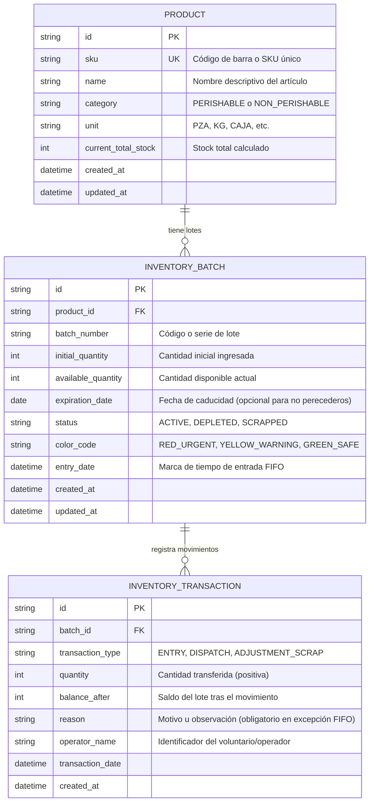
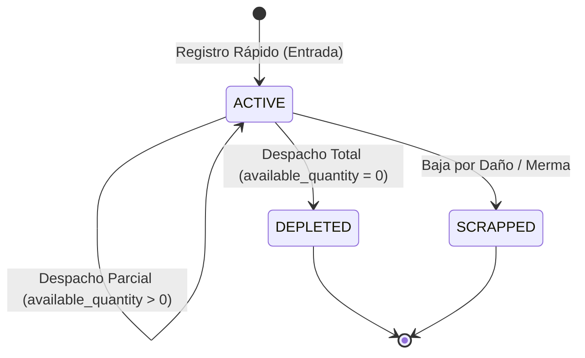

# Data Model: Control de Inventario FIFO por Códigos de Colores y Registro Rápido

**Feature**: `specs/001-fifo-color-inventory`  
**Date**: 2026-11-04  
**Status**: Ready  

---

## 1. Diagrama Entidad-Relación (Mermaid)

---

## 2. Definición Detallada de Entidades

### 2.1 Entidad `Product` (Artículo)
Representa el elemento de catálogo base.

| Campo | Tipo | Restricciones | Descripción |
| :--- | :--- | :--- | :--- |
| `id` | `UUID / String` | PK, No nulo | Identificador interno único |
| `sku` | `String` | Unique, Indexado, Min 3 chars | Código de barras estándar (EAN-13, Code-128) o SKU interno |
| `name` | `String` | No nulo, Min 2 chars | Denominación del producto (e.g. "Leche Entera 1L") |
| `category` | `Enum` | `PERISHABLE`, `NON_PERISHABLE` | Determina si la caducidad afecta el cálculo semáforo |
| `unit` | `String` | Default: `"UNIDAD"` | Unidad física de conteo |
| `current_total_stock` | `Integer` | `>= 0`, Calculado | Suma de `available_quantity` de lotes activos |

### 2.2 Entidad `InventoryBatch` (Lote de Inventario)
Representa la unidad básica de trazabilidad y gestión FIFO.

| Campo | Tipo | Restricciones | Descripción |
| :--- | :--- | :--- | :--- |
| `id` | `UUID / String` | PK, No nulo | Identificador único del lote |
| `product_id` | `UUID / String` | FK -> `Product.id` | Producto al que pertenece el lote |
| `batch_number` | `String` | No nulo | Número o identificador de lote impreso |
| `initial_quantity` | `Integer` | `> 0` | Cantidad con la que ingresó el lote |
| `available_quantity` | `Integer` | `>= 0` y `<= initial_quantity` | Saldo físico actual apto para despacho |
| `expiration_date` | `Date / Null` | Requerido si categoría es perecedero | Fecha de vencimiento para la regla semáforo |
| `status` | `Enum` | `ACTIVE`, `DEPLETED`, `SCRAPPED` | Estado operativo del lote |
| `color_code` | `Enum (Virtual)` | `RED_URGENT`, `YELLOW_WARNING`, `GREEN_SAFE` | Calculado en tiempo real según fecha actual vs `expiration_date` |
| `entry_date` | `DateTime` | No nulo, Indexado | Marca temporal estricta para desempate FIFO |

### 2.3 Entidad `InventoryTransaction` (Movimiento de Inventario)
Bitácora inmutable de auditoría para cada modificación de stock.

| Campo | Tipo | Restricciones | Descripción |
| :--- | :--- | :--- | :--- |
| `id` | `UUID / String` | PK, No nulo | Identificador de la transacción |
| `batch_id` | `UUID / String` | FK -> `InventoryBatch.id` | Lote físico afectado |
| `transaction_type` | `Enum` | `ENTRY`, `DISPATCH`, `ADJUSTMENT_SCRAP` | Tipo de movimiento registrado |
| `quantity` | `Integer` | `> 0` | Cantidad de unidades involucradas |
| `balance_after` | `Integer` | `>= 0` | Existencia remanente en el lote tras el evento |
| `reason` | `String / Null` | Obligatorio si viola FIFO | Justificación o nota operativa |
| `operator_name` | `String` | No nulo | Nombre o ID del voluntario responsable |
| `transaction_date` | `DateTime` | Default: `now()` | Fecha y hora exacta de ejecución |

---

## 3. Reglas de Negocio y Transiciones de Estado

### 3.1 Ciclo de Vida del Lote (`InventoryBatch.status`)

### 3.2 Lógica de Cálculo del Color Semáforo (`color_code`)
La función de cálculo se evalúa al consultar el lote respecto a la fecha actual (`now`):
$$\Delta t = \text{expiration\_date} - \text{now}$$

- **Caso 1: $\Delta t \le 48\text{ horas}$ o expirado:**  
  Color: `RED_URGENT` (`#E53E3E`). Icono: `AlertTriangle`. Prioridad de salida: **1 (Máxima)**.
- **Caso 2: $48\text{ horas} < \Delta t \le 7\text{ días}$:**  
  Color: `YELLOW_WARNING` (`#D69E2E`). Icono: `RotateCw`. Prioridad de salida: **2 (Media)**.
- **Caso 3: $\Delta t > 7\text{ días}$ o producto no perecedero:**  
  Color: `GREEN_SAFE` (`#38A169`). Icono: `Box`. Prioridad de salida: **3 (Baja / Por fecha de ingreso)**.

### 3.3 Regla de Partición Automática de Despachos
Cuando una orden de despacho solicita una cantidad $Q_{req}$:
1. El sistema recupera los lotes activos ordenados por:
   `ORDER BY (CASE color_code WHEN 'RED_URGENT' THEN 1 WHEN 'YELLOW_WARNING' THEN 2 ELSE 3 END) ASC, expiration_date ASC NULLS LAST, entry_date ASC`
2. Itera sobre los lotes deduciendo $\min(Q_{req\_rem}, \text{batch.available\_quantity})$ hasta que $Q_{req\_rem} = 0$.
3. Genera una transacción individual por cada lote afectado en una sola operación atómica (DB Transaction).

